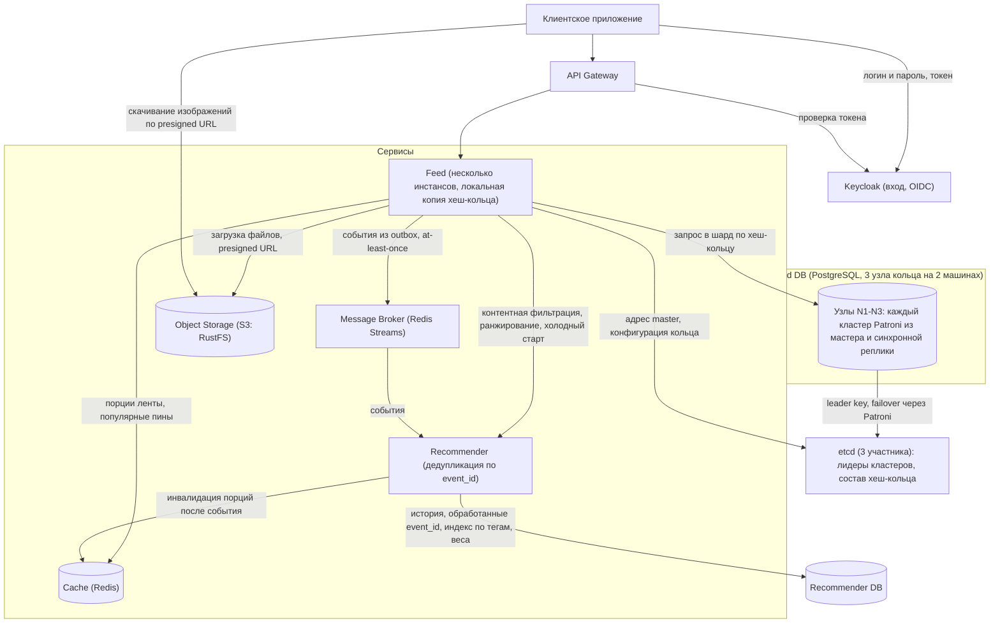
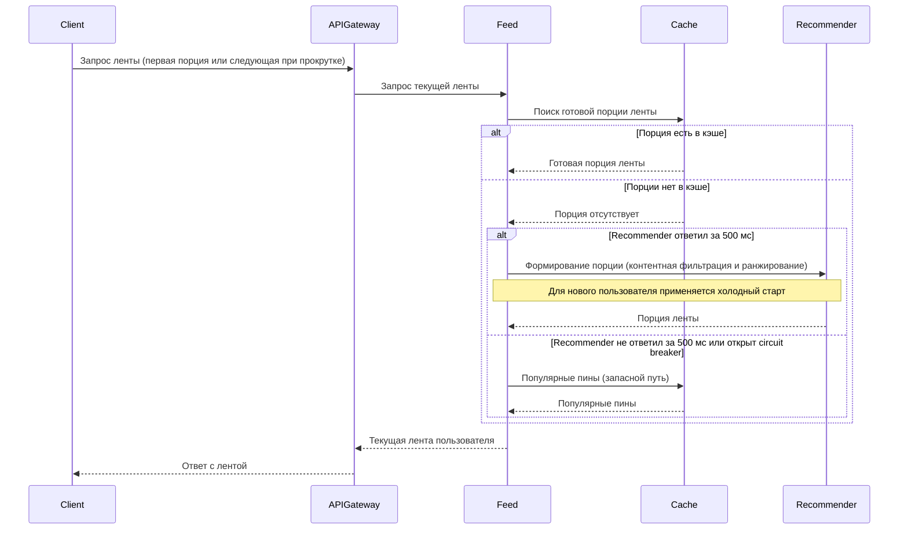
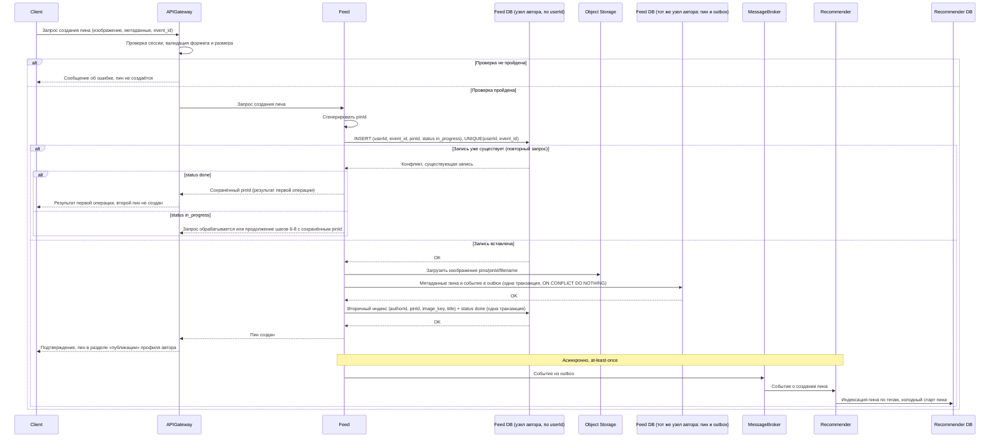
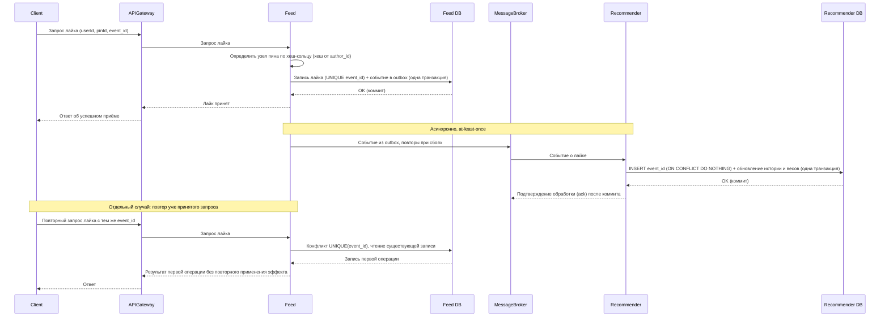
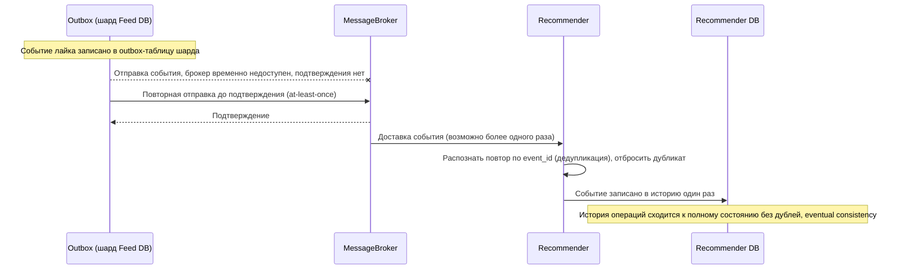
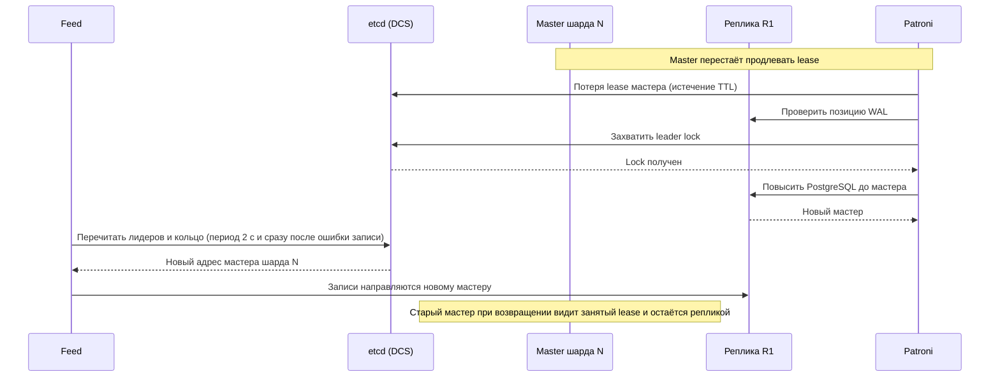

# Техническое решение проекта «Лента картинок»

## Введение
- **Цель проекта:**  
  «Лента картинок» - учебный проект, реализующий прототип распределенной платформы для просмотра картинок, которые предположительно интересны пользователю, в формате бесконечной ленты. Проект демонстрирует ключевые принципы построения отказоустойчивых и масштабируемых распределённых приложений.
- **Задачи:**  
  - Реализовать платформу для просмотра и загрузки пинов, работающую на нескольких узлах приложения.
  - Спроектировать и реализовать формирование персональной ленты на основе просмотров и лайков пользователя.
  - Организовать асинхронную обработку событий взаимодействия (лайки, просмотры) с семантикой at-least-once и идемпотентным потребителем.
  - Применить шардирование и репликацию данных, обеспечив устойчивость к отказу отдельных узлов.
  - Закрепить на практике решения проблем распределённых систем: ненадёжной доставки, частичных отказов, распределения данных, согласованности.
- **Основания для разработки:**  
  Учебный групповой проект по курсу: «Основы распределённых вычислений», СПбГУ, 2026 г.
- **Команда:**  
  - Полина Яни — Team Leader, Full stack разработчик, ML специалист.
  - Ляшенко Александр — Full stack разработчик, ML специалист.
  - Всеволод Новгородцев — Full stack разработчик, архитектор.
  - Богдан Щенников — Full stack разработчик, тестировщик. 
---

## Глоссарий
| Термин        | Определение |
|---------------|-------------|
| **Пользователь** | Зарегистрированный клиент системы, имеющий профиль и историю действий. |
| **Сессия** | Состояние авторизованного пользователя с ограниченным сроком жизни. Токен выдаёт Keycloak при входе; API Gateway проверяет его и передаёт в Feed логин пользователя (userId), по которому определяется узел пользователя. |
| **Пин** | Базовая единица контента: изображение с метаданными (название, описание, теги, автор). |
| **Лента** | Персонализированный бесконечно прокручиваемый список пинов, формируемый для пользователя. |
| **Лайк** | Явное положительное действие пользователя, сигнал рекомендательной системе о релевантности пина. |
| **Просмотр** | Факт показа пина пользователю в ленте (impression). |
| **Тег** | Ключевое слово, описывающее содержание пина; используется для контентной фильтрации. |
| **Рекомендательная система** | Комплекс алгоритмов, анализирующих поведение пользователей и контент для подбора релевантных пинов. |
| **Контентная фильтрация** | Метод рекомендаций на основе характеристик контента (теги, категории, эмбеддинги). |
| **Ранжирование** | сортировка отобранных пинов по оценке релевантности (сумма весов интересов пользователя по совпавшим тегам) |
| **Холодный старт** | Нехватка данных о новом пользователе или новом пине. Для нового пользователя выдаётся подборка популярных пинов. Новый пин уже имеет теги, поэтому показывается пользователям с подходящими интересами, а для набора первых просмотров получает ограниченную квоту показов |
| **Брокер сообщений** | Компонент для асинхронной передачи событий (лайки, просмотры) между сервисами. |
| **Очередь** | Буфер сообщений, позволяющий развязать отправителя и получателя. |
| **At-least-once** | Семантика доставки сообщений: сообщение доставляется как минимум один раз, возможны дубли. |
| **Идемпотентность** | Свойство операции: повторное выполнение с теми же параметрами не изменяет результат — эффект применяется один раз. |
| **Дедупликация** | Отбрасывание повторно доставленных сообщений по идентификатору. |
| **Кэш** | Быстрое хранилище часто запрашиваемых данных (горячих картинок, готовых порций ленты). |
| **Шард** | Независимый сегмент данных, размещённый на отдельном узле или группе узлов. |
| **Хеш-кольцо** | Способ распределения ключей по узлам (consistent hashing): узлы и ключи отображаются хеш-функцией на кольцо, ключ принадлежит ближайшему узлу по часовой стрелке. |
| **Реплика** | Копия данных, поддерживаемая для отказоустойчивости и распределения чтения. |
| **Консистентность** | Свойство, гарантирующее согласованность состояния данных между репликами. |
| **Eventual consistency** | Модель согласованности: при отсутствии новых обновлений все копии данных со временем сходятся к одному состоянию. Подходит для ленты, где небольшая задержка допустима. |
| **Failover** | Автоматическое переключение на резервный узел при отказе основного. |
| **Деградация** | Контролируемое снижение качества сервиса (например, неперсонализированная лента) вместо полной недоступности. | 
| **Узел кольца (логический узел)** | Единица распределения данных на хеш-кольце (N1, N2, ...). Каждый узел кольца — отдельный кластер Patroni из мастера и синхронной реплики на разных физических машинах. Состав кольца можно менять: при добавлении или удалении узла переезжают только ключи с его дуг. |
| **Физический узел** | Машина стенда (ноутбук). Хранит мастеров одних узлов кольца и реплики других, поэтому отказ машины не делает недоступным ни один узел кольца. |
| **userId (логин)** | Уникальное имя пользователя, выбираемое при регистрации. Совпадает с идентификатором пользователя и используется как ключ шардирования; после регистрации не изменяется. |
---

## Функциональные требования
Система должна предоставлять следующие функции:
1. Регистрация, авторизация и аутентификация пользователя.
2. Генерация персонализированной ленты.
3. Формирование ленты для новых пользователей без истории из популярных пинов.
4. Бесконечный скроллинг.
5. Взаимодействие с контентом - пользователь должен иметь возможность отмечать понравившиеся изображения (например, ставить «лайк»).
6. Просмотр публичного профиля.
7. Добавление пинов — авторизованный пользователь должен иметь возможность загрузить изображение и указать метаданные (название, описание, теги). Загруженный пин отображается в профиле автора и становится кандидатом для показа в лентах других пользователей.

---

## Нефункциональные требования
1. Отказоустойчивость: выход из строя одного узла не должен приводить к полной неработоспособности приложения. Пользователь должен продолжать получать картинки (возможно, с деградацией качества рекомендаций). Система выдерживает отказ любого одного экземпляра PostgreSQL: его роль берёт синхронная реплика на другой физической машине. На стенде из двух ноутбуков переживается и отказ ноутбука 2 целиком (кворум etcd — на ноутбуке 1).
2. Доступность: Система должна отдавать приоритет доступности над строгой консистентностью (задержка в отображении лайка предпочтительнее недоступности ленты).
3. Масштабируемость: распределение ключей задаётся хеш-кольцом (consistent hashing). Узел кольца можно добавить или удалить без остановки сервиса: переезжают только ключи с его дуг (примерно 1/N всех ключей), остальные остаются на месте. Состав кольца хранится в etcd, инстансы Feed перечитывают его без перезапуска.
4. Доставка событий: семантика at-least-once. Повторная доставка события (лайк, просмотр) не приводит к повторному применению его эффекта. Получение дубликата не изменяет состояние системы повторно: счётчик лайков не увеличивается второй раз, а вес взаимодействия в рекомендациях не удваивается.
5. Безопасность: пароли хранятся только в виде хеша; сессии имеют ограниченный срок жизни;

---

## Пользовательские сценарии
### Сценарий: авторизация в системе

1. Пользователь открывает приложение и вводит свои учетные данные (или регистрирует новый аккаунт).
2. Система проверяет данные и создает персональную сессию пользователя для формирования индивидуальной истории взаимодействий.

### Сценарий: просмотр бесконечной ленты

1. Пользователь прокручивает ленту картинок в клиентском приложении.
   - Если пользователь только что зарегистрировался и не имеет истории взаимодействий, система отображает подборку популярных пинов в качестве начальной выдачи.
2. При приближении к концу текущего списка приложение автоматически запрашивает у системы следующую порцию изображений.
3. Система возвращает новый пакет картинок, и пользователь продолжает просмотр.

### Сценарий: взаимодействие с контентом (лайк)

1. Пользователь нажимает кнопку «лайк» на понравившейся картинке в ленте.
2. Клиентское приложение отправляет отметку о лайке в систему.
3. Система фиксирует действие пользователя и передаёт его в механизм рекомендаций для учёта интересов при дальнейшей выдаче контента.
4. Кнопка «лайк» визуально меняет состояние ( закрашивается сердечком ). Пользователь видит подтверждение того, что действие принято.
5. Пользователь продолжает прокрутку ленты. При формировании следующих порций контента система отдаёт приоритет изображениям, тематически близким к тем, которые пользователь отметил лайком.
6. В обновлённой ленте пользователь наблюдает больше картинок той же категории/стилистики, что и понравившаяся.

### Сценарий: просмотр своего профиля

1. Пользователь переходит в раздел своего профиля через клиентское приложение.
2. Система запрашивает и отображает персональную информацию пользователя, статистику (количество загруженных картинок, лайков).

### Сценарий: просмотр чужого профиля

1. Пользователь выбирает профиль другого участника системы (например, кликнув по имени автора картинки).
2. Клиентское приложение отправляет запрос на получение данных указанного пользователя.
3. Система возвращает публичную информацию чужого профиля (аватар, имя, публичные загрузки), которую пользователь видит на экране.

### Сценарий: добавление пина
 
1. Пользователь переходит к форме создания пина в клиентском приложении.
2. Пользователь выбирает изображение и заполняет название, описание и теги.
3. Клиентское приложение отправляет данные в систему.
4. Система проверяет формат и размер изображения, сохраняет изображение и метаданные и привязывает пин к автору.
   - Если проверка не пройдена, система возвращает понятное сообщение об ошибке, и пин не создаётся.
5. Пользователь видит подтверждение, а пин появляется в разделе «публикации» его профиля.
6. Пин становится кандидатом для формирования лент: на него распространяется контентная фильтрация по тегам, а для набора первых просмотров и лайков используется механизм холодного старта пина.

---

##  Архитектура системы

Основные компоненты:

1. API Gateway — входная точка в систему: маршрутизация клиентских запросов, проверка токена (вход через Keycloak, OIDC), валидация формата и размера изображения.
2. Feed — основной сервис, отвечающий за формирование ленты, приём лайков и просмотров, создание пинов и профили; состоит из нескольких инстансов (по одному на каждой машине), каждый держит локальную копию хеш-кольца и адресов мастеров; конфигурация кольца и лидеры кластеров хранятся в etcd и перечитываются инстансами каждые 2 с и сразу после ошибки записи.
3. Recommender — сервис рекомендательной системы, отвечающий за контентную фильтрацию, ранжирование и холодный старт; потребляет события из Message Broker с дедупликацией по event_id и хранит историю взаимодействий и веса интересов в Recommender DB.
4. Feed DB — база данных сервиса Feed (PostgreSQL), шардированная с помощью consistent hashing. Ключ шардирования — userId (логин) пользователя: его профиль, сессии, ключи идемпотентности, индекс публикаций, а также его пины вместе с их лайками, просмотрами и событиями outbox лежат на одном узле кольца. 3 узла кольца (N1–N3), каждый — отдельный кластер Patroni из мастера и синхронной реплики на разных физических машинах (всего 6 инстансов PostgreSQL). Подробности — в разделе «Схема шардирования».
5. Recommender DB — база данных сервиса Recommender: история взаимодействий, таблица обработанных event_id, индекс пинов по тегам, веса интересов.
6. etcd (кластер из 3 участников) — DCS для Patroni (ключ лидера каждого кластера) и хранилище состава хеш-кольца (`/feed/ring`). Инстансы Feed читают из него адрес текущего мастера каждого узла кольца и состав кольца.
7. Patroni — агент при каждом инстансе PostgreSQL: продлевает lease в etcd, проводит failover и switchover, понижает старого мастера до реплики (fencing).
8. Object Storage (S3-совместимое: RustFS, совместимый с MinIO по API; образы MinIO удалены из публичных реестров) — хранилище файлов изображений, ключ объекта `pins/<pinId>/<filename>`. Файлы не зависят от инстанса Feed и переживают его отказ. Клиент получает изображение напрямую по presigned URL, который выдаёт Feed.
9. Cache (Redis) — готовые порции ленты (ключ по пользователю) и список популярных пинов для запасного пути.
10. Message Broker (Redis Streams) — поток `events` с группой потребителей `recommender`: доставка at-least-once, подтверждение (XACK) после коммита в Recommender DB, повторная выдача неподтверждённых сообщений (XAUTOCLAIM).

### Схема шардирования

Физические узлы (машины стенда): 2 ноутбука.
Узлы кольца: 3 (N1–N3), каждый — кластер Patroni: мастер на одной машине, синхронная реплика на другой.

**Ключ шардирования — userId (логин).** На узле пользователя лежат: users, sessions, ключи идемпотентности (pin_requests), индекс публикаций (author_pins), его пины (pins), лайки и просмотры этих пинов (interactions) и события outbox о них.
- Почему автор, а не pinId: создание пина (запись идемпотентности, пин, индекс публикаций, событие outbox) и лайк вместе с событием outbox выполняются одной локальной транзакцией одного узла, без распределённых транзакций. Профиль и список публикаций — один запрос к одному узлу.
- Клиент знает автора каждого пина из ленты и передаёт author_id вместе с pinId; если не передал, узел пина находится обходом всех узлов.
- Логин выбирается при регистрации, уникален и не меняется, поэтому узел определяется напрямую по логину, без таблиц соответствия.

**Хеш-кольцо.** Ключ хешируется (SHA-256, первые 8 байт) и попадает на кольцо; он принадлежит узлу, ближайший токен которого идёт следующим по часовой стрелке. Каждый узел размещён на кольце 256 токенами (виртуальными узлами), поэтому доли ключей близки к равным.

**Размещение (стенд из двух ноутбуков):**

| Узел кольца | Ноутбук 1 | Ноутбук 2 |
|---|---|---|
| N1 (feed-n1) | n1a | n1b |
| N2 (feed-n2) | n2b | n2a |
| N3 (feed-n3) | n3a | n3b |
| etcd | etcd1, etcd2 | etcd3 |

Кто из пары мастер, решает Patroni; после отказа роли меняются.

**Добавление и удаление узла кольца** — онлайн, без остановки Feed (утилита `python -m server.migrate add N4` / `remove N4`): копирование переезжающих ключей → публикация нового кольца в etcd → пауза, пока все Feed переключатся → догоняющее копирование, сверка и удаление на старых узлах. Переезжают только ключи с дуг добавленного (удалённого) узла. Подробно — в техническом сценарии «Добавление узла кольца».

**Ограничения:** «вирусный» пин или очень активный автор нагружает один узел; лента собирается со всех узлов (scatter-gather); логин нельзя изменить после регистрации.

---

## Технические сценарии

### Сценарий: регистрация, вход, профиль
1. Клиент регистрируется или входит через API Gateway, который обращается к Keycloak (OIDC, пароли хранятся в Keycloak в виде хеша, токены имеют ограниченный срок жизни).
2. При каждом запросе API Gateway проверяет токен и передаёт в Feed логин пользователя (userId) в заголовке X-User-Id. Логин является ключом шардирования.
3. При первом обращении пользователя Feed создаёт его профиль в users на узле по хешу от userId (INSERT ... ON CONFLICT DO NOTHING).
4. Свой профиль: чтение users и статистики из узла по userId. Чужой профиль: публичные поля users из узла по userId автора (userId автора известен из пина в ленте).
5. Список публикаций автора: индекс (authorId, pinId, image_key, title) на узле автора; при создании пина Feed пишет запись в этот индекс в той же транзакции. Список — один запрос к узлу автора.

### Сценарий: просмотр ленты

1. Клиент отправляет в API Gateway запрос.
2. API Gateway перенаправляет запрос в сервис Feed для получения текущей ленты.
3. Feed ищет порцию в кэше (ключ по пользователю и номеру порции). Если порции нет, Feed запрашивает её у Recommender (контентная фильтрация и ранжирование; для нового пользователя — холодный старт).
4. Запасной путь: если Recommender не ответил за 500 мс, Feed отдаёт популярные пины из кэша, а при его отсутствии — недавние пины, собранные запросом ко всем шардам. Такая порция кэшируется на 10 с. Гарантия: просмотр продолжается без персонализации, пока доступна Feed DB; при недоступности и Feed DB, и кэша лента не гарантируется. При повторных ошибках Recommender срабатывает circuit breaker: Feed обращается к запасному пути сразу, не дожидаясь таймаута.
5. Устаревание кэша: порция живёт не более 60 с. Кроме того, после применения события пользователя (лайк, просмотр) Recommender удаляет из кэша порции этого пользователя, и следующая выдача строится с обновлёнными весами.
6. Учёт просмотров: показом считается отрисовка одного пина в одной порции ленты. Клиент создаёт event_id для каждого показа и при повторной отправке того же показа использует тот же event_id; новый показ того же пина получает новый event_id. Запрос с userId, pinId, event_id обрабатывается так же, как лайк, но сохраняется как запись типа «просмотр»: запись о показе и событие outbox фиксируются одной транзакцией шарда пина; дальше событие доставляется в Recommender (at-least-once) и дедуплицируется по event_id.

### Сценарий: добавление пина

1. Клиент отправляет в API Gateway запрос на создание пина: изображение, метаданные (название, описание, теги) и идемпотентный ключ event_id (генерируется клиентом и сохраняется при повторных отправках).
2. API Gateway проверяет сессию пользователя, валидирует формат и размер изображения и перенаправляет запрос в сервис Feed.
3. Если проверка не пройдена, система возвращает понятное сообщение об ошибке, и пин не создаётся.
4. Feed генерирует pinId (случайный UUID) и вставляет в узел пользователя (по userId) запись идемпотентности (userId, event_id, pinId, status = in_progress) с ограничением UNIQUE(userId, event_id). Так pinId навсегда связан с ключом запроса.
5. Если запись уже существует: при status = done Feed возвращает сохранённый pinId (результат первой операции); при status = in_progress и возрасте записи менее 30 с — ответ «запрос обрабатывается» (защита от параллельных дублей); при in_progress старше 30 с (сбой Feed) — Feed при повторном запросе клиента продолжает шаги 6–8 с сохранённым pinId.
6. Feed загружает файл в Object Storage по ключу pins/pinId/filename (повторная загрузка с тем же pinId безопасно перезаписывает тот же объект).
7. Feed в одной транзакции узла автора (по userId) записывает метаданные пина (pinId — первичный ключ, INSERT ... ON CONFLICT DO NOTHING), запись в индекс публикаций автора, событие о создании в outbox и переводит запись идемпотентности в status = done.
8. Если запись не прошла из-за отказа мастера узла, Feed перечитывает лидера из etcd и повторяет шаги 4–7 с тем же event_id и pinId (см. сценарий failover).
9. Feed подтверждает создание, пин появляется в «публикациях» автора.
10. Асинхронно: событие из outbox пересылается в Message Broker (at-least-once) и попадает в Recommender, где пин индексируется по тегам.
Ограничение: если произошёл сбой между шагами 6 и 7, запись остаётся в status = in_progress, и операция идемпотентно доводится до конца при повторном запросе клиента с тем же event_id.

### Когда создание пина считается успешным:
- После того, как файл доступен в Object Storage, метаданные зафиксированы в шарде пина, а запись идемпотентности переведена в status = done.
- Если файл загружен в Object Storage, но транзакция в Feed DB не зафиксирована (отказ Feed), пин не существует (на него нет ссылок в БД, и он никому не отображается). При повторном запросе с тем же event_id сервис использует сохранённый pinId и перезаписывает объект по тому же ключу pins/pinId/filename.
- Если данные записаны, а ответ клиенту не дошёл — повтор с тем же event_id возвращает результат первой операции.

### Путь чтения: 
- Клиент получает из ленты или профиля ключ объекта (presigned URL) и загружает файл напрямую из Object Storage.
- Feed не проксирует файлы.

### Сценарий: постановка лайка

1. Клиент отправляет в API Gateway запрос с параметрами: userId, pinId, author_id (автор пина, известен из ленты) и идемпотентный ключ event_id (генерируется клиентом и сохраняется при повторных отправках того же запроса).
2. API Gateway перенаправляет запрос в сервис Feed.
3. Инстанс Feed по локальной копии хеш-кольца определяет узел пина (хеш от author_id) и адрес его текущего мастера.
4. Feed в одной транзакции выбранного шарда: добавляет запись о лайке с уникальным event_id и записывает событие в outbox. Подтверждение клиенту отправляется после коммита.
5. Feed сообщает API Gateway об успешном приёме, API Gateway возвращает клиенту ответ.
6. Асинхронно: событие из outbox пересылается в Message Broker с повторами (at-least-once) и передаётся в Recommender. Recommender в одной транзакции Recommender DB добавляет event_id в таблицу обработанных (INSERT ... ON CONFLICT DO NOTHING) и, только если вставка произошла, обновляет историю взаимодействий и веса интересов. Подтверждение (ack) брокеру отправляется после коммита этой транзакции. Если потребитель упал между коммитом и ack, событие придёт повторно и будет отброшено по event_id; если упал до коммита, транзакция откатится и событие будет обработано заново.
7. Повторный запрос лайка с тем же event_id: вставка нарушает UNIQUE(event_id), Feed читает существующую запись и возвращает результат первой операции без повторного применения эффекта и без новой записи в outbox.

### Сценарий: потеря и повторная доставка события

1. После выполнения лайка событие записано в outbox-таблицу шарда.
2. Message Broker временно недоступен — отправка события не подтверждается.
3. Отправитель outbox повторяет отправку до подтверждения — семантика at-least-once.
4. В результате брокер сообщений может доставить событие в Recommender более одного раза.
5. Recommender распознаёт повтор по event_id (дедупликация) и отбрасывает дубликат.
6. История операций сходится к полному состоянию без дублей — eventual consistency.

### Сценарий: отказ мастера шарда Feed DB (failover)

1. БД и репликация: PostgreSQL, потоковая репликация WAL; каждый узел кольца — отдельный кластер Patroni: мастер + синхронная реплика на разных физических машинах. DCS — кластер etcd из 3 участников.
2. Настройки синхронности: в Patroni включены synchronous_mode: true и synchronous_node_count: 1. Список синхронных реплик для synchronous_standby_names формирует сам Patroni. Режим synchronous_mode_strict = false (выключен): если синхронная реплика временно недоступна, мастер продолжает принимать записи локально (доступность важнее, НФТ 2), но гарантия синхронной записи на этот период не действует.
3. Обнаружение отказа и выбор нового мастера: мастер удерживает leader lease в etcd (ttl = 15 с, loop_wait = 5 с, retry_timeout = 5 с). При отказе мастера lease истекает. Patroni проверяет позицию WAL реплики на другом физическом узле. Кандидат сначала захватывает leader lock в etcd, и только после этого Patroni повышает его PostgreSQL до мастера. Это исключает одновременную работу двух мастеров.
4. Обновление маршрутизации Feed: инстансы Feed перечитывают лидеров (ключ `/service/<scope>/leader` и `conn_url` участника) из etcd каждые 2 с. При ошибке или таймауте записи Feed делает retry с экспоненциальным backoff в течение общего окна до 30 секунд, каждый раз заново определяя лидера шарда в etcd. Если за это время мастер не появился, HTTP-запрос не висит бесконечно: клиент получает ответ с временной ошибкой (HTTP 503/таймаут) и инструкцией повторить операцию с тем же event_id. Повтор безопасен: UNIQUE(event_id) не даёт применить лайк дважды. Остальные шарды на живых узлах работают без перерыва.
5. Fencing: потеряв lease или связь с кворумом etcd, старый master понижается до реплики и не принимает записи; при возвращении подключается как реплика (при необходимости `pg_rewind`). Два одновременных писателя в шарде невозможны.
6. **Сохранность:** клиенту подтверждается лайк только после фиксации WAL на синхронной реплике, поэтому подтверждённый лайк при failover не теряется. Outbox лежит в той же БД и реплицируется вместе с лайком. Время переключения складывается из истечения lease, выборов, повышения PostgreSQL и обновления маршрутизации; точный верхний предел не фиксируется, так как зависит от состояния реплик.
7. Ограничения: выдерживается отказ любого одного экземпляра PostgreSQL и отказ ноутбука 2 целиком; при отказе ноутбука 1 etcd теряет кворум (на нём 2 из 3 участников), и автоматический failover невозможен. Redis, Recommender и хранилище картинок работают на ноутбуке 1 и не реплицируются. При получении клиентом временной ошибки во время failover (исчерпано окно retry) клиент должен повторить запрос с тем же event_id — это гарантирует, что операция не будет применена дважды и не потеряется.

### Сценарий: добавление узла кольца (перенос ключей)

1. Оператор поднимает кластер Patroni нового узла N4 (мастер и реплика на разных машинах) и запускает `python -m server.migrate add N4`.
2. Утилита регистрирует N4 в `/feed/ring` (в scopes, но ещё не в кольце) и находит его мастера в etcd.
3. Копирование: для каждого старого узла перебираются ключи (логины); ключи, владельцем которых в новом кольце становится N4, копируются на N4 вместе со всеми строками (пины, лайки, outbox, индекс публикаций, идемпотентность). На старых узлах строки остаются, Feed продолжает писать и читать по старому кольцу.
4. Переключение: в `/feed/ring` записывается новое кольцо (epoch + 1, запись compare-and-put по ревизии ключа). Все инстансы Feed применяют его не позже чем через 2 с.
5. Пауза (2 × период обновления + 3 с), чтобы все Feed точно переключились.
6. Догоняющий перенос: строки ключей копируются ещё раз (догоняются записи, сделанные до переключения; вставки идемпотентны, изменяемые поля обновляются), сверяется число строк на источнике, и только после этого строки удаляются со старого узла. Если строки ключа изменились за время прохода, проход повторяется.
7. Проверка: в новом кольце не осталось ключей не на своём узле.
8. Удаление узла (`remove N4`) — то же самое в обратную сторону; затем N4 убирается из scopes.

Свойство consistent hashing: при добавлении N4 переезжают только ключи, попавшие на дуги N4 (около 1/4 ключей при переходе 3 → 4), и все они переезжают именно на N4; при удалении — только ключи N4. Лайки и лента работают всё время переноса.

Ограничение: запись, начатая по старому кольцу и завершившаяся позже паузы, обнаруживается сверкой числа строк, и проход повторяется.

---

## План разработки и тестирования

### Включает:

- Реализация сервиса ленты.
- Реализация шардирования Feed DB (consistent hashing), развёртывание кластеров Patroni и роутинга записей Feed на актуального мастера (чтение лидера из etcd, повторы с backoff).
- Реализация потребления событий в Recommender с дедупликацией по event_id и хранением истории взаимодействий (Recommender DB).

### План разработки:

1. Проектирование API для ленты и истории пинов.
2. Реализация API Gateway (роутинг, валидация).
3. Реализация сервиса Feed (логика ленты, идемпотентность по event_id).
4. Интеграция с готовой базой данных (Feed DB).
5. Интеграция с готовой базой данных (Recommender DB).
6. Интеграция с брокером сообщений (Message Broker).
7. Реализация рекомендательной системы (Recommender): контентная фильтрация по тегам, ранжирование пинов на основе лайков и просмотров пользователя, холодный старт для новых пользователей и новых пинов, потребление событий с дедупликацией по event_id.
8. Реализация шардирования Feed DB: хеш-кольцо (256 токенов на узел), роутинг запросов по userId (автору), онлайн-перенос ключей при добавлении и удалении узла кольца.
9. Развёртывание 6 инстансов PostgreSQL под управлением Patroni (3 узла кольца: мастер + синхронная реплика) + кластер etcd из 3 участников на двух машинах; реализация роутинга Feed на мастера, повторов при failover и circuit breaker для Recommender.
10. Документирование API.
11. Развёртывание Object Storage (S3-совместимое, RustFS) и загрузка/чтение изображений по presigned URL.

### План тестирования:

- Модульные тесты для логики ленты (Feed).
- Интеграционные тесты взаимодействия Feed и Feed DB, Recommender и Recommender DB, взаимодействия через Message Broker.
- Тесты API Gateway (валидные/невалидные запросы).
- Тест идемпотентности лайка: повторный запрос с тем же event_id не приводит к повторному применению эффекта.
- Тест дедупликации событий: повторная доставка события в Recommender не создаёт дубль в истории взаимодействий.
- Тест failover: остановка мастера шарда под нагрузкой — система продолжает обслуживать запросы.
- Тест сходимости истории (eventual consistency): после прекращения новых операций история соответствует выполненным лайкам.
- Тест добавления и удаления узла кольца: переезжают только ключи нового (удаляемого) узла, лайки продолжают работать во время переноса, данные не теряются и не дублируются.
- Проверка граничных случаев (несуществующий пользователь, несуществующий пин и т.д.).
- Тест перезапуска Recommender между обработкой и подтверждением: остановить после коммита, но до ack; перезапустить; брокер доставляет повторно; эффект не применён дважды.
- Тест идемпотентности создания пина: повтор с тем же event_id возвращает тот же pinId, второй пин не создаётся (включая случай падения между созданием пина и обновлением статуса идемпотентности).
- Тест деградации: остановить Recommender — после срабатывания circuit breaker лента продолжает отдаваться из кэша популярных пинов.
- Тест устаревания кэша: после лайка и истечения TTL порция ленты обновляется; при инвалидации — обновляется сразу.
- Тест списка публикаций автора: постраничный вывод с узла автора без пропусков и повторов.
- Тест параллельного создания пина: два одновременных запроса с одним event_id дают один пин.
- Тест идемпотентности просмотра: повтор доставки показа не создаёт дубль; новый показ того же пина учитывается отдельно.
- Тест регистрации: повторная регистрация с занятым логином отклоняется, существующий пользователь не перезаписывается.
- Тест сессии: запрос без токена или с недействительным токеном отклоняется API Gateway.
- Тест отказа физической машины: выключить ноутбук 2; Patroni повышает реплики на ноутбуке 1 для узлов, чьи мастера были на ноутбуке 2; лайки и лента продолжают работать, etcd сохраняет кворум.

Подробный план тестирования со сценариями, шагами и ожидаемыми результатами — в docs/testplan.md.

### Definition of Done (DoD):

- Пользователь регистрируется и входит в систему.
- Пользователь загружает пин (изображение + метаданные), пин появляется в разделе «публикации» его профиля.
- Пользователь видит ленту и прокручивает её (бесконечный скролл).
- Новый пользователь без истории видит популярную выдачу.
- После лайка в следующих порциях ленты наблюдаются пины с похожими тегами (учёт лайка в рекомендациях).
- Пользователь открывает чужой профиль и видит публикации автора.
- Дополнительно (распределённые гарантии): повторный запрос лайка с тем же event_id не применяет эффект повторно; повторная доставка события не создаёт дубль в истории; лайк выполняется после отказа мастера шарда (failover); лайки продолжают работать при добавлении узла кольца (онлайн-перенос ключей).
