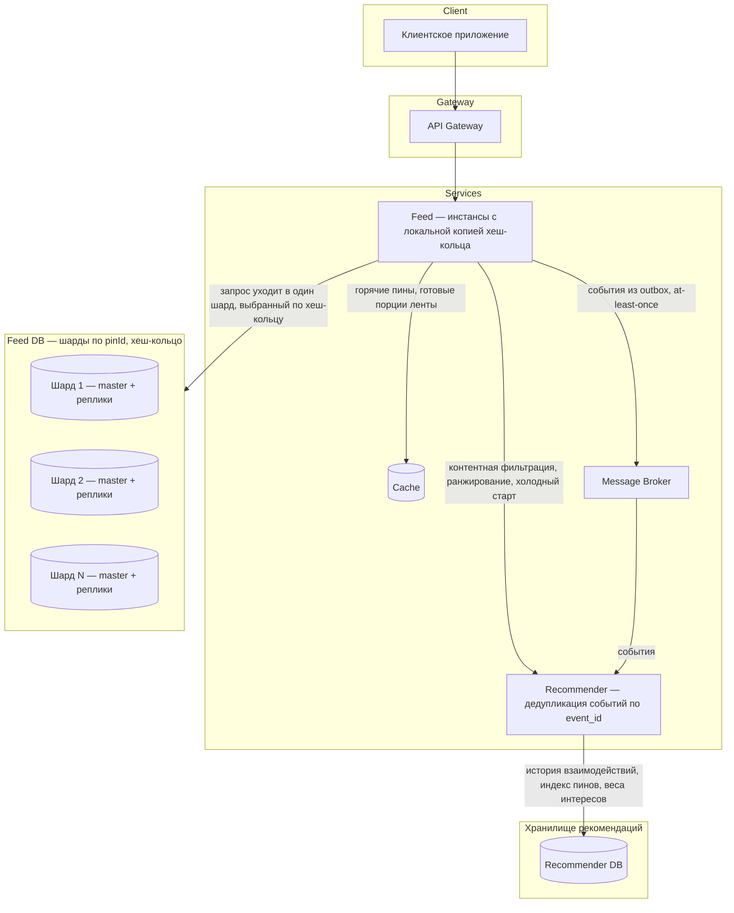
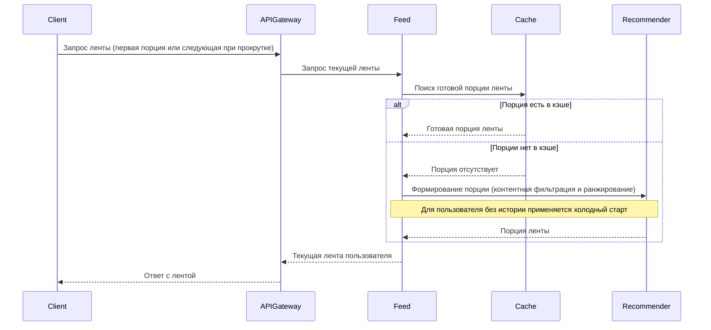
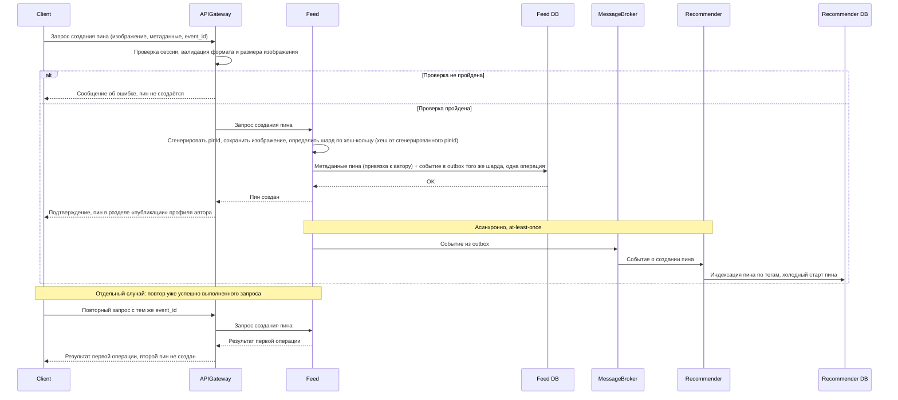
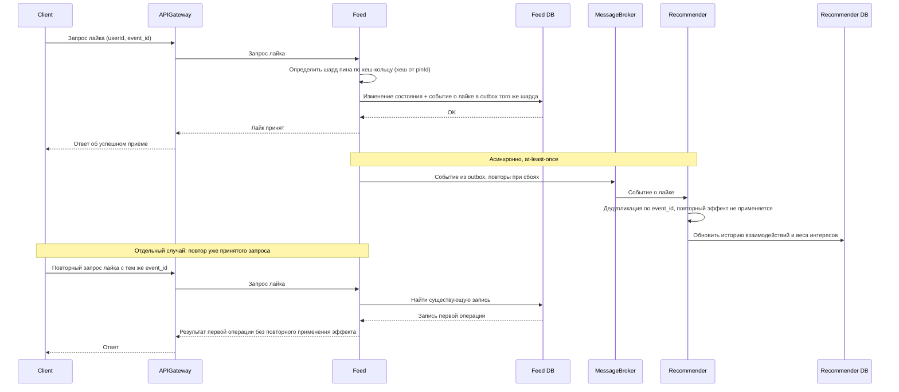
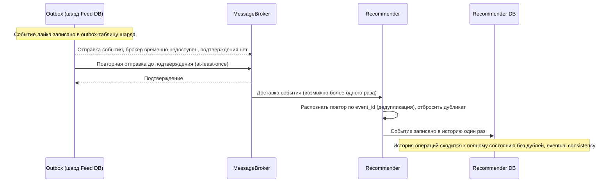

# Техническое решение проекта «Лента картинок»

## Введение
- **Цель проекта:**  
  «Лента картинок» - учебный проект, реализующий прототип распределенной платформы для просмотра картинок, которые предположительно интересны пользователю, в формате бесконечной ленты. Проект демонстрирует ключевые принципы построения отказоустойчивых и масштабируемых распределённых приложений.
- **Задачи:**  
  - Реализовать платформу для просмотра и загрузки пинов, работающую на нескольких узлах приложения.
  - Спроектировать и реализовать формирование персональной ленты на основе просмотров и лайков пользователя.
  - Организовать асинхронную обработку событий взаимодействия (лайки, просмотры) с семантикой at-least-once и идемпотентным потребителем.
  - Применить шардирование и репликацию данных, обеспечив устойчивость к отказу отдельных узлов.
  - Закрепить на практике решения проблем распределённых систем: ненадёжной доставки, частичных отказов, распределения данных, согласованности и порядка событий.
- **Основания для разработки:**  
  Учебный групповой проект по курсу: «Основы распределённых вычислений», СПбГУ, 2026 г.
- **Команда:**  
  - Полина Яни — Team Leader, Full stack разработчик, ML специалист.
  - Ляшенко Александр — Full stack разработчик, ML специалист.
  - Всеволод Новгородцев — Full stack разработчик, архитектор.
  - Богдан Щенников — Full stack разработчик, тестировщик. 
---

## Глоссарий
| Термин        | Определение |
|---------------|-------------|
| **Пользователь** | Зарегистрированный клиент системы, имеющий профиль и историю действий. |
| **Сессия** | Состояние авторизованного пользователя, по которому система связывает его запросы и историю взаимодействий. |
| **Пин** | Базовая единица контента: изображение с метаданными (название, описание, теги, автор). |
| **Лента** | Персонализированный бесконечно прокручиваемый список пинов, формируемый для пользователя. |
| **Лайк** | Явное положительное действие пользователя, сигнал рекомендательной системе о релевантности пина. |
| **Просмотр** | Факт показа пина пользователю в ленте (impression). |
| **Тег** | Ключевое слово, описывающее содержание пина; используется для контентной фильтрации. |
| **Рекомендательная система** | Комплекс алгоритмов, анализирующих поведение пользователей и контент для подбора релевантных пинов. |
| **Контентная фильтрация** | Метод рекомендаций на основе характеристик контента (теги, категории, эмбеддинги). |
| **Ранжирование** | Сортировка отобранных пинов по вероятности взаимодействия пользователя с ними. |
| **Холодный старт** | Ситуация, когда у пользователя (или пина) нет истории взаимодействий и персонализация невозможна. |
| **Брокер сообщений** | Компонент для асинхронной передачи событий (лайки, просмотры) между сервисами. |
| **Очередь** | Буфер сообщений, позволяющий развязать отправителя и получателя. |
| **At-least-once** | Семантика доставки сообщений: сообщение доставляется как минимум один раз, возможны дубли. |
| **Идемпотентность** | Свойство операции: повторное выполнение с теми же параметрами не изменяет результат — эффект применяется один раз. |
| **Дедупликация** | Отбрасывание повторно доставленных сообщений по идентификатору. |
| **Кэш** | Быстрое хранилище часто запрашиваемых данных (горячих картинок, готовых порций ленты). |
| **Шард** | Независимый сегмент данных, размещённый на отдельном узле или группе узлов. |
| **Хеш-кольцо** | Способ распределения ключей по узлам (consistent hashing): узлы и ключи отображаются хеш-функцией на кольцо, ключ принадлежит ближайшему узлу по часовой стрелке. |
| **Реплика** | Копия данных, поддерживаемая для отказоустойчивости и распределения чтения. |
| **Консистентность** | Свойство, гарантирующее согласованность состояния данных между репликами. |
| **Eventual consistency** | Модель согласованности: при отсутствии новых обновлений все копии данных со временем сходятся к одному состоянию. Подходит для ленты, где небольшая задержка допустима. |
| **Failover** | Автоматическое переключение на резервный узел при отказе основного. |
| **Деградация** | Контролируемое снижение качества сервиса (например, неперсонализированная лента) вместо полной недоступности. | 
---

## Функциональные требования
Система должна предоставлять следующие функции:
1. Регистрация, авторизация и аутентификация пользователя.
2. Генерация персонализированной ленты.
3. Формирование ленты для новых пользователей без истории из популярных пинов.
4. Бесконечный скроллинг.
5. Взаимодействие с контентом - пользователь должен иметь возможность отмечать понравившиеся изображения (например, ставить «лайк»).
6. Просмотр публичного профиля.
7. Добавление пинов — авторизованный пользователь должен иметь возможность загрузить изображение и указать метаданные (название, описание, теги). Загруженный пин отображается в профиле автора и становится кандидатом для показа в лентах других пользователей.

---

## Нефункциональные требования
1. Отказоустойчивость: выход из строя одного узла не должен приводить к полной неработоспособности приложения. Пользователь должен продолжать получать картинки (возможно, с деградацией качества рекомендаций).
2. Доступность: Система должна отдавать приоритет доступности над строгой консистентностью (задержка в отображении лайка предпочтительнее недоступности ленты).
3. Масштабируемость: добавление или удаление узлов хранилища не требует изменения логики приложения; при изменении состава узлов перемещается только диапазон ключей соседних сегментов хеш-кольца.
4. Доставка событий: семантика at-least-once. Повторная доставка события (лайк, просмотр) не приводит к повторному применению его эффекта. Получение дубликата не изменяет состояние системы повторно: счётчик лайков не увеличивается второй раз, а вес взаимодействия в рекомендациях не удваивается.
5. Безопасность: пароли хранятся только в виде хеша; сессии имеют ограниченный срок жизни;

---

## Пользовательские сценарии
### Сценарий: авторизация в системе

1. Пользователь открывает приложение и вводит свои учетные данные (или регистрирует новый аккаунт).
2. Система проверяет данные и создает персональную сессию пользователя для формирования индивидуальной истории взаимодействий.

### Сценарий: просмотр бесконечной ленты

1. Пользователь прокручивает ленту картинок в клиентском приложении.
   - Если пользователь только что зарегистрировался и не имеет истории взаимодействий, система отображает подборку популярных пинов в качестве начальной выдачи.
2. При приближении к концу текущего списка приложение автоматически запрашивает у системы следующую порцию изображений.
3. Система возвращает новый пакет картинок, и пользователь продолжает просмотр.

### Сценарий: взаимодействие с контентом (лайк)

1. Пользователь нажимает кнопку «лайк» на понравившейся картинке в ленте.
2. Клиентское приложение отправляет отметку о лайке в систему.
3. Система фиксирует действие пользователя и передаёт его в механизм рекомендаций для учёта интересов при дальнейшей выдаче контента.
4. Кнопка «лайк» визуально меняет состояние ( закрашивается сердечком ). Пользователь видит подтверждение того, что действие принято.
5. Пользователь продолжает прокрутку ленты. При формировании следующих порций контента система отдаёт приоритет изображениям, тематически близким к тем, которые пользователь отметил лайком.
6. В обновлённой ленте пользователь наблюдает больше картинок той же категории/стилистики, что и понравившаяся.

### Сценарий: просмотр своего профиля

1. Пользователь переходит в раздел своего профиля через клиентское приложение.
2. Система запрашивает и отображает персональную информацию пользователя, статистику (количество загруженных картинок, лайков).

### Сценарий: просмотр чужого профиля

1. Пользователь выбирает профиль другого участника системы (например, кликнув по имени автора картинки).
2. Клиентское приложение отправляет запрос на получение данных указанного пользователя.
3. Система возвращает публичную информацию чужого профиля (аватар, имя, публичные загрузки), которую пользователь видит на экране.

### Сценарий: добавление пина
 
1. Пользователь переходит к форме создания пина в клиентском приложении.
2. Пользователь выбирает изображение и заполняет название, описание и теги.
3. Клиентское приложение отправляет данные в систему.
4. Система проверяет формат и размер изображения, сохраняет изображение и метаданные и привязывает пин к автору.
   - Если проверка не пройдена, система возвращает понятное сообщение об ошибке, и пин не создаётся.
5. Пользователь видит подтверждение, а пин появляется в разделе «публикации» его профиля.
6. Пин становится кандидатом для формирования лент: на него распространяется контентная фильтрация по тегам, а для набора первых просмотров и лайков используется механизм холодного старта пина.

---

##  Архитектура системы

Основные компоненты:

1. API Gateway — входная точка в систему, отвечает за маршрутизацию клиентских запросов.
2. Feed — основной сервис, отвечающий за формирование ленты, приём лайков и просмотров; состоит из нескольких инстансов, каждый держит локальную копию хеш-кольца.
3. Recommender — сервис рекомендательной системы, отвечающий за контентную фильтрацию, ранжирование и холодный старт; потребляет события из Message Broker с дедупликацией по event_id и хранит историю взаимодействий и веса интересов в Recommender DB.
4. Feed DB — база данных сервиса Feed; шардированная с помощью consistent hashing (хеш-кольцо, виртуальные узлы) по pinId; каждый шард — single-master с репликами, переключение на реплику при отказе мастера (failover) реализуется системой.
5. Recommender DB — база данных сервиса Recommender: история взаимодействий, индекс пинов по тегам, веса интересов.
6. Message Broker — брокер сообщений, обеспечивающий асинхронную передачу событий из Feed в Recommender.
7. Cache — кэш горячих пинов и готовых порций ленты.

---

## Технические сценарии

### Сценарий: просмотр ленты

1. Клиент отправляет в API Gateway запрос.
2. API Gateway перенаправляет запрос в сервис Feed для получения текущей ленты.
3. Feed ищет готовую порцию ленты в кэше; если она отсутствует, формирует её через Recommender (контентная фильтрация и ранжирование), а для пользователя без истории применяет холодный старт.
4. Feed возвращает текущую ленту для указанного пользователя.
5. API Gateway возвращает клиенту ответ с лентой.

### Сценарий: добавление пина

1. Клиент отправляет в API Gateway запрос на создание пина: изображение, метаданные (название, описание, теги) и идемпотентный ключ event_id (генерируется клиентом и сохраняется при повторных отправках того же запроса).
2. API Gateway проверяет сессию пользователя, валидирует формат и размер изображения и перенаправляет запрос в сервис Feed.
3. Если проверка не пройдена, система возвращает понятное сообщение об ошибке, и пин не создаётся.
4. Feed генерирует pinId, сохраняет изображение, а метаданные пина записывает в Feed DB: по локальной копии хеш-кольца определяется шард (хеш от сгенерированного pinId), пин привязывается к автору.
5. Событие о создании пина записывается в outbox-таблицу того же шарда в рамках той же операции, что и сохранение метаданных.
6. Feed сообщает API Gateway об успешном создании, API Gateway возвращает клиенту подтверждение, и пин отображается в разделе «публикации» профиля автора.
7. Асинхронно: событие из outbox пересылается в Message Broker (at-least-once) и передаётся в Recommender, где пин индексируется по тегам и попадает в механизм холодного старта пина.
8. Повторный запрос с тем же event_id не создаёт второй пин: система возвращает результат первой операции.

### Сценарий: постановка лайка

1. Клиент отправляет в API Gateway запрос с параметрами: userId и идемпотентный ключ event_id (генерируется клиентом и сохраняется при повторных отправках того же запроса).
2. API Gateway перенаправляет запрос в сервис Feed.
3. Инстанс Feed по локальной копии хеш-кольца определяет шард пина (хеш от pinId).
4. Событие о лайке записывается в outbox-таблицу там, где и изменение состояния.
5. Feed сообщает API Gateway об успешном приёме, API Gateway возвращает клиенту ответ.
6. Асинхронно: событие из outbox пересылается в Message Broker с повторами при сбоях (at-least-once) и передаётся в Recommender, который дедуплицирует его по event_id и обновляет историю взаимодействий и веса интересов.
7. Повторный запрос лайка с тем же event_id: система находит существующую запись и возвращает результат первой операции без повторного применения эффекта.

### Сценарий: потеря и повторная доставка события

1. После выполнения лайка событие записано в outbox-таблицу шарда.
2. Message Broker временно недоступен — отправка события не подтверждается.
3. Отправитель outbox повторяет отправку до подтверждения — семантика at-least-once.
4. В результате брокер сообщений может доставить событие в Recommender более одного раза.
5. Recommender распознаёт повтор по event_id (дедупликация) и отбрасывает дубликат.
6. История операций сходится к полному состоянию без дублей — eventual consistency.

---

## План разработки и тестирования

### Включает:

- Реализация сервиса ленты.
- Реализация шардирования Feed DB (consistent hashing), репликации и собственной логики failover.
- Реализация потребления событий в Recommender с дедупликацией по event_id и хранением истории взаимодействий (Recommender DB).

### План разработки:

1. Проектирование API для ленты и истории пинов.
2. Реализация API Gateway (роутинг, валидация).
3. Реализация сервиса Feed (логика ленты, идемпотентность по event_id).
4. Интеграция с готовой базой данных (Feed DB).
5. Интеграция с готовой базой данных (Recommender DB).
6. Интеграция с брокером сообщений (Message Broker).
7. Реализация рекомендательной системы (Recommender): контентная фильтрация по тегам, ранжирование пинов на основе лайков и просмотров пользователя, холодный старт для новых пользователей и новых пинов, потребление событий с дедупликацией по event_id.
8. Реализация шардирования Feed DB: хеш-кольцо с виртуальными узлами и роутинг запросов по pinId.
9. Реализация репликации шардов и логики failover.
10. Документирование API.

### План тестирования:

- Модульные тесты для логики ленты (Feed).
- Интеграционные тесты взаимодействия Feed и Feed DB, Recommender и Recommender DB, взаимодействия через Message Broker.
- Тесты API Gateway (валидные/невалидные запросы).
- Тест идемпотентности лайка: повторный запрос с тем же event_id не приводит к повторному применению эффекта.
- Тест дедупликации событий: повторная доставка события в Recommender не создаёт дубль в истории взаимодействий.
- Тест failover: остановка мастера шарда под нагрузкой — система продолжает обслуживать запросы.
- Тест сходимости истории (eventual consistency): после прекращения новых операций история соответствует выполненным лайкам.
- Тест масштабирования: лайки продолжают корректно работать при добавлении узла в хеш-кольцо.
- Нагрузочное тестирование.
- Проверка граничных случаев (несуществующий пользователь, несуществующий пин и т.д.).

### Definition of Done (DoD):

- Проведено 5 лайков.
- Повторный запрос лайка с тем же event_id не приводит к повторному применению эффекта.
- Повторная доставка события не создаёт дубль в истории взаимодействий.
- Лайк выполняется успешно после отказа мастера шарда (failover).
- Лайки продолжают работать при добавлении узла в хеш-кольцо.
