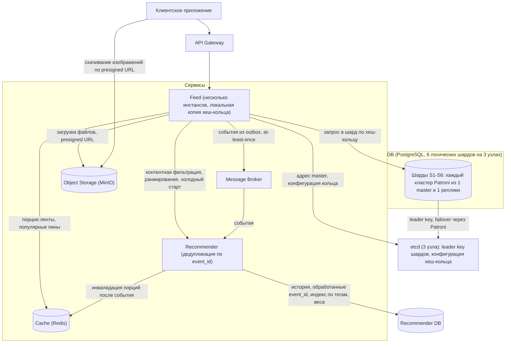
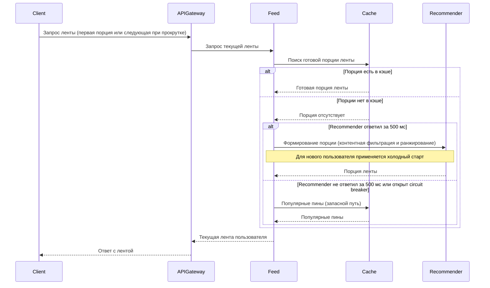
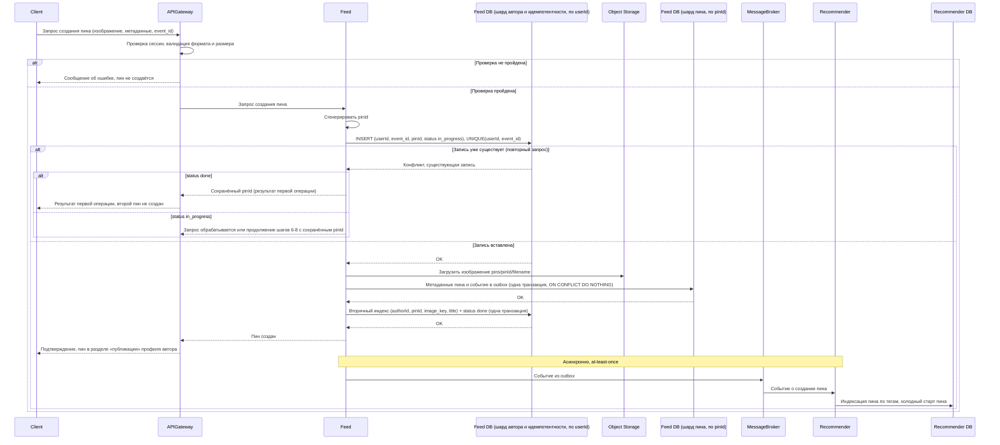
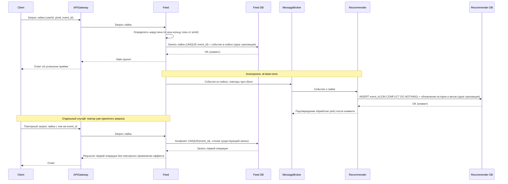
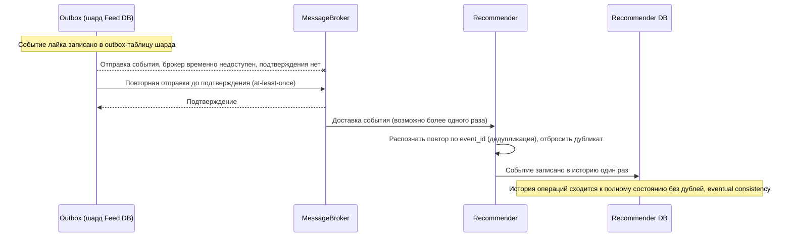
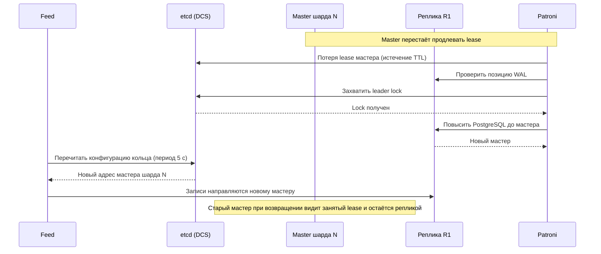

# Техническое решение проекта «Лента картинок»

## Введение
- **Цель проекта:**  
  «Лента картинок» - учебный проект, реализующий прототип распределенной платформы для просмотра картинок, которые предположительно интересны пользователю, в формате бесконечной ленты. Проект демонстрирует ключевые принципы построения отказоустойчивых и масштабируемых распределённых приложений.
- **Задачи:**  
  - Реализовать платформу для просмотра и загрузки пинов, работающую на нескольких узлах приложения.
  - Спроектировать и реализовать формирование персональной ленты на основе просмотров и лайков пользователя.
  - Организовать асинхронную обработку событий взаимодействия (лайки, просмотры) с семантикой at-least-once и идемпотентным потребителем.
  - Применить шардирование и репликацию данных, обеспечив устойчивость к отказу отдельных узлов.
  - Закрепить на практике решения проблем распределённых систем: ненадёжной доставки, частичных отказов, распределения данных, согласованности.
- **Основания для разработки:**  
  Учебный групповой проект по курсу: «Основы распределённых вычислений», СПбГУ, 2026 г.
- **Команда:**  
  - Полина Яни — Team Leader, Full stack разработчик, ML специалист.
  - Ляшенко Александр — Full stack разработчик, ML специалист.
  - Всеволод Новгородцев — Full stack разработчик, архитектор.
  - Богдан Щенников — Full stack разработчик, тестировщик. 
---

## Глоссарий
| Термин        | Определение |
|---------------|-------------|
| **Пользователь** | Зарегистрированный клиент системы, имеющий профиль и историю действий. |
| **Сессия** | Состояние авторизованного пользователя с ограниченным сроком жизни. Идентифицируется токеном вида `<userId>.<случайная_строка>`, по которому система находит шард пользователя и связывает его запросы и историю взаимодействий. |
| **Пин** | Базовая единица контента: изображение с метаданными (название, описание, теги, автор). |
| **Лента** | Персонализированный бесконечно прокручиваемый список пинов, формируемый для пользователя. |
| **Лайк** | Явное положительное действие пользователя, сигнал рекомендательной системе о релевантности пина. |
| **Просмотр** | Факт показа пина пользователю в ленте (impression). |
| **Тег** | Ключевое слово, описывающее содержание пина; используется для контентной фильтрации. |
| **Рекомендательная система** | Комплекс алгоритмов, анализирующих поведение пользователей и контент для подбора релевантных пинов. |
| **Контентная фильтрация** | Метод рекомендаций на основе характеристик контента (теги, категории, эмбеддинги). |
| **Ранжирование** | сортировка отобранных пинов по оценке релевантности (сумма весов интересов пользователя по совпавшим тегам) |
| **Холодный старт** | Нехватка данных о новом пользователе или новом пине. Для нового пользователя выдаётся подборка популярных пинов. Новый пин уже имеет теги, поэтому показывается пользователям с подходящими интересами, а для набора первых просмотров получает ограниченную квоту показов |
| **Брокер сообщений** | Компонент для асинхронной передачи событий (лайки, просмотры) между сервисами. |
| **Очередь** | Буфер сообщений, позволяющий развязать отправителя и получателя. |
| **At-least-once** | Семантика доставки сообщений: сообщение доставляется как минимум один раз, возможны дубли. |
| **Идемпотентность** | Свойство операции: повторное выполнение с теми же параметрами не изменяет результат — эффект применяется один раз. |
| **Дедупликация** | Отбрасывание повторно доставленных сообщений по идентификатору. |
| **Кэш** | Быстрое хранилище часто запрашиваемых данных (горячих картинок, готовых порций ленты). |
| **Шард** | Независимый сегмент данных, размещённый на отдельном узле или группе узлов. |
| **Хеш-кольцо** | Способ распределения ключей по узлам (consistent hashing): узлы и ключи отображаются хеш-функцией на кольцо, ключ принадлежит ближайшему узлу по часовой стрелке. |
| **Реплика** | Копия данных, поддерживаемая для отказоустойчивости и распределения чтения. |
| **Консистентность** | Свойство, гарантирующее согласованность состояния данных между репликами. |
| **Eventual consistency** | Модель согласованности: при отсутствии новых обновлений все копии данных со временем сходятся к одному состоянию. Подходит для ленты, где небольшая задержка допустима. |
| **Failover** | Автоматическое переключение на резервный узел при отказе основного. |
| **Деградация** | Контролируемое снижение качества сервиса (например, неперсонализированная лента) вместо полной недоступности. | 
| **Логический шард** | Единица распределения данных на хеш-кольце; у каждого логического шарда один master и одна синхронная реплика на другом физическом узле. Ключ принадлежит ровно одному логическому шарду, и это соответствие не меняется при добавлении физических узлов. |
| **Физический узел** | Сервер стенда. Хранит несколько мастеров и реплик разных логических шардов; при добавлении узла на него переносятся целые логические шарды. |
| **userId (логин)** | Уникальное имя пользователя, выбираемое при регистрации. Совпадает с идентификатором пользователя и используется как ключ шардирования; после регистрации не изменяется. |
---

## Функциональные требования
Система должна предоставлять следующие функции:
1. Регистрация, авторизация и аутентификация пользователя.
2. Генерация персонализированной ленты.
3. Формирование ленты для новых пользователей без истории из популярных пинов.
4. Бесконечный скроллинг.
5. Взаимодействие с контентом - пользователь должен иметь возможность отмечать понравившиеся изображения (например, ставить «лайк»).
6. Просмотр публичного профиля.
7. Добавление пинов — авторизованный пользователь должен иметь возможность загрузить изображение и указать метаданные (название, описание, теги). Загруженный пин отображается в профиле автора и становится кандидатом для показа в лентах других пользователей.

---

## Нефункциональные требования
1. Отказоустойчивость: выход из строя одного узла не должен приводить к полной неработоспособности приложения. Пользователь должен продолжать получать картинки (возможно, с деградацией качества рекомендаций). Система выдерживает отказ одного физического узла (из трех): мастера, расположенные на нём, заменяются репликами на других узлах.
2. Доступность: Система должна отдавать приоритет доступности над строгой консистентностью (задержка в отображении лайка предпочтительнее недоступности ленты).
3. Масштабируемость: ключ - логический шард определяется хеш-кольцом и не меняется при изменении состава физических узлов. Добавление физического узла не требует изменения логики приложения: на него переносятся целые логические шарды (вместе с репликами), данные между логическими шардами не перехешируются.
4. Доставка событий: семантика at-least-once. Повторная доставка события (лайк, просмотр) не приводит к повторному применению его эффекта. Получение дубликата не изменяет состояние системы повторно: счётчик лайков не увеличивается второй раз, а вес взаимодействия в рекомендациях не удваивается.
5. Безопасность: пароли хранятся только в виде хеша; сессии имеют ограниченный срок жизни;

---

## Пользовательские сценарии
### Сценарий: авторизация в системе

1. Пользователь открывает приложение и вводит свои учетные данные (или регистрирует новый аккаунт).
2. Система проверяет данные и создает персональную сессию пользователя для формирования индивидуальной истории взаимодействий.

### Сценарий: просмотр бесконечной ленты

1. Пользователь прокручивает ленту картинок в клиентском приложении.
   - Если пользователь только что зарегистрировался и не имеет истории взаимодействий, система отображает подборку популярных пинов в качестве начальной выдачи.
2. При приближении к концу текущего списка приложение автоматически запрашивает у системы следующую порцию изображений.
3. Система возвращает новый пакет картинок, и пользователь продолжает просмотр.

### Сценарий: взаимодействие с контентом (лайк)

1. Пользователь нажимает кнопку «лайк» на понравившейся картинке в ленте.
2. Клиентское приложение отправляет отметку о лайке в систему.
3. Система фиксирует действие пользователя и передаёт его в механизм рекомендаций для учёта интересов при дальнейшей выдаче контента.
4. Кнопка «лайк» визуально меняет состояние ( закрашивается сердечком ). Пользователь видит подтверждение того, что действие принято.
5. Пользователь продолжает прокрутку ленты. При формировании следующих порций контента система отдаёт приоритет изображениям, тематически близким к тем, которые пользователь отметил лайком.
6. В обновлённой ленте пользователь наблюдает больше картинок той же категории/стилистики, что и понравившаяся.

### Сценарий: просмотр своего профиля

1. Пользователь переходит в раздел своего профиля через клиентское приложение.
2. Система запрашивает и отображает персональную информацию пользователя, статистику (количество загруженных картинок, лайков).

### Сценарий: просмотр чужого профиля

1. Пользователь выбирает профиль другого участника системы (например, кликнув по имени автора картинки).
2. Клиентское приложение отправляет запрос на получение данных указанного пользователя.
3. Система возвращает публичную информацию чужого профиля (аватар, имя, публичные загрузки), которую пользователь видит на экране.

### Сценарий: добавление пина
 
1. Пользователь переходит к форме создания пина в клиентском приложении.
2. Пользователь выбирает изображение и заполняет название, описание и теги.
3. Клиентское приложение отправляет данные в систему.
4. Система проверяет формат и размер изображения, сохраняет изображение и метаданные и привязывает пин к автору.
   - Если проверка не пройдена, система возвращает понятное сообщение об ошибке, и пин не создаётся.
5. Пользователь видит подтверждение, а пин появляется в разделе «публикации» его профиля.
6. Пин становится кандидатом для формирования лент: на него распространяется контентная фильтрация по тегам, а для набора первых просмотров и лайков используется механизм холодного старта пина.

---

##  Архитектура системы

Основные компоненты:

1. API Gateway — входная точка в систему, отвечает за маршрутизацию клиентских запросов.
2. Feed — основной сервис, отвечающий за формирование ленты, приём лайков и просмотров; состоит из нескольких инстансов, каждый держит локальную копию хеш-кольца; конфигурация кольца хранится в etcd и периодически перечитывается инстансами.
3. Recommender — сервис рекомендательной системы, отвечающий за контентную фильтрацию, ранжирование и холодный старт; потребляет события из Message Broker с дедупликацией по event_id и хранит историю взаимодействий и веса интересов в Recommender DB.
4. Feed DB — база данных сервиса Feed (PostgreSQL), шардированная с помощью consistent hashing: пины, лайки, просмотры и outbox — по pinId; пользователи, сессии и ключи идемпотентности — по userId (userId — это логин пользователя). 6 логических шардов размещены на 3 физических узлах; каждый логический шард — отдельный кластер Patroni из 1 master и 1 реплики на разных узлах (всего 12 инстансов PostgreSQL). Подробности — в разделе «Схема шардирования».
5. Recommender DB — база данных сервиса Recommender: история взаимодействий, таблица обработанных event_id, индекс пинов по тегам, веса интересов.
6. etcd (кластер из 3 узлов) — DCS для Patroni (leader key каждого логического шарда) и хранилище конфигурации хеш-кольца и размещения шардов. Инстансы Feed читают из него адрес текущего мастера шарда и каждые 5 с обновляют локальную копию кольца.
7. Patroni — агент при каждом инстансе PostgreSQL: продлевает lease в etcd, проводит failover и switchover, понижает старого мастера до реплики (fencing).
8. Object Storage (MinIO) — хранилище файлов изображений, ключ объекта `pins/<pinId>/<filename>`. Файлы не зависят от инстанса Feed и переживают его отказ. Клиент получает изображение напрямую по presigned URL, который выдаёт Feed.
9. Cache (Redis) — готовые порции ленты (ключ по пользователю) и список популярных пинов для запасного пути.

### Схема шардирования (физические и логические шарды)

Физические узлы: 3.
Логические шарды: 6 (2 мастера и 2 реплики на каждый физический узел).

**Ключи шардирования:**
- Пины, лайки и outbox: pinId (случайный UUID: равномерное распределение, нет горячих диапазонов). Лайк и событие в outbox лежат на одном шарде, поэтому фиксируются одной локальной транзакцией без распределённых транзакций.
- Users, sessions, ключи идемпотентности: userId (логин пользователя). Логин выбирается при регистрации, уникален и не меняется, поэтому при входе шард определяется напрямую по логину, без дополнительных таблиц соответствия. Уникальность логина обеспечивается PRIMARY KEY таблицы users на шарде этого userId.
- Список публикаций автора: вторичный индекс (authorId, pinId, image_key, title) на шарде по authorId.

**Хеш-кольцо.** Ключ хешируется и попадает на кольцо; он принадлежит логическому шарду, ближайшему по часовой стрелке. Каждый логический шард размещён на кольце 64 токенами (виртуальными узлами), чтобы доли ключей были близки к равным. Число логических шардов (6) и хеш-функция фиксированы, поэтому соответствие ключ → логический шард не меняется при изменении состава физических узлов.

**Размещение (на каждый логический шард — отдельный кластер PostgreSQL + Patroni, всего 12 инстансов, по 4 на узел: 2 мастера + 2 реплики):**

| Логический шард | Master | Реплика |
|---|---|---|
| S1 | Узел 1 | Узел 2 |
| S2 | Узел 1 | Узел 3 |
| S3 | Узел 2 | Узел 3 |
| S4 | Узел 2 | Узел 1 |
| S5 | Узел 3 | Узел 1 |
| S6 | Узел 3 | Узел 2 |

**Добавление физического узла.** На новом узле поднимается реплика переносимого логического шарда, догоняет WAL, затем выполняется patronictl switchover (если переносится master), после чего старый экземпляр удаляется. Хеш-функция, кольцо и ключи не меняются; перемещаются только целые логические шарды. Для 3 → 4 узлов распределение мастеров получится 2/2/1/1 (равномерно оно только при 3 и 6 узлах).

**Ограничения:** число логических шардов фиксировано (делить шард на части не поддерживается); «вирусный» пин нагружает один шард; запросы без pinId идут через вторичный индекс; логин (userId) нельзя изменить после регистрации.

---

## Технические сценарии

### Сценарий: регистрация, вход, профиль
1. Клиент отправляет запрос регистрации или входа (логин и пароль) в API Gateway.
2. API Gateway передаёт запрос в Feed. Логин пользователя является его userId: Feed определяет шард по хешу от userId.
   - Регистрация: Feed вставляет запись в users (пароль хранится как хеш argon2/bcrypt). Уникальность логина обеспечивается PRIMARY KEY: если такой логин уже занят, вставка не проходит, и пользователь получает сообщение «логин занят».
   - Вход: Feed читает запись из users по логину и сверяет хеш пароля.
3. При успешной регистрации или входе Feed создаёт запись в sessions на том же шарде (токен — криптографически случайная строка, ограниченный TTL) и возвращает клиенту токен вида `<userId>.<случайная_строка>`. При каждом последующем запросе API Gateway передаёт токен в Feed, Feed берёт userId из токена, определяет шард и проверяет сессию в sessions (токен существует и срок жизни не истёк).
4. Свой профиль: чтение users и статистики из шарда по userId. Чужой профиль: публичные поля users из шарда по userId автора (userId автора известен из пина в ленте).
5. Список публикаций автора: вторичный индекс (authorId, pinId, image_key, title) на шарде по authorId; при создании пина Feed пишет запись в этот индекс. Список — один запрос к шарду автора, без scatter-gather по шардам пинов.

### Сценарий: просмотр ленты

1. Клиент отправляет в API Gateway запрос.
2. API Gateway перенаправляет запрос в сервис Feed для получения текущей ленты.
3. Feed ищет порцию в кэше (ключ по пользователю и номеру порции). Если порции нет, Feed запрашивает её у Recommender (контентная фильтрация и ранжирование; для нового пользователя — холодный старт).
4. Запасной путь: если Recommender не ответил за 500 мс, Feed отдаёт популярные пины из кэша, а при его отсутствии — недавние пины, собранные запросом ко всем шардам. Такая порция кэшируется на 10 с. Гарантия: просмотр продолжается без персонализации, пока доступна Feed DB; при недоступности и Feed DB, и кэша лента не гарантируется. При повторных ошибках Recommender срабатывает circuit breaker: Feed обращается к запасному пути сразу, не дожидаясь таймаута.
5. Устаревание кэша: порция живёт не более 60 с. Кроме того, после применения события пользователя (лайк, просмотр) Recommender удаляет из кэша порции этого пользователя, и следующая выдача строится с обновлёнными весами.
6. Учёт просмотров: показом считается отрисовка одного пина в одной порции ленты. Клиент создаёт event_id для каждого показа и при повторной отправке того же показа использует тот же event_id; новый показ того же пина получает новый event_id. Запрос с userId, pinId, event_id обрабатывается так же, как лайк, но сохраняется как запись типа «просмотр»: запись о показе и событие outbox фиксируются одной транзакцией шарда пина; дальше событие доставляется в Recommender (at-least-once) и дедуплицируется по event_id.

### Сценарий: добавление пина

1. Клиент отправляет в API Gateway запрос на создание пина: изображение, метаданные (название, описание, теги) и идемпотентный ключ event_id (генерируется клиентом и сохраняется при повторных отправках).
2. API Gateway проверяет сессию пользователя, валидирует формат и размер изображения и перенаправляет запрос в сервис Feed.
3. Если проверка не пройдена, система возвращает понятное сообщение об ошибке, и пин не создаётся.
4. Feed генерирует pinId (случайный UUID) и вставляет в шард пользователя (по userId) запись идемпотентности (userId, event_id, pinId, status = in_progress) с ограничением UNIQUE(userId, event_id). Так pinId навсегда связан с ключом запроса.
5. Если запись уже существует: при status = done Feed возвращает сохранённый pinId (результат первой операции); при status = in_progress и возрасте записи менее 30 с — ответ «запрос обрабатывается» (защита от параллельных дублей); при in_progress старше 30 с (сбой Feed) — Feed при повторном запросе клиента продолжает шаги 6–8 с сохранённым pinId.
6. Feed загружает файл в Object Storage по ключу pins/pinId/filename (повторная загрузка с тем же pinId безопасно перезаписывает тот же объект).
7. Feed в одной транзакции шарда пина (по pinId) записывает метаданные (pinId — первичный ключ, INSERT ... ON CONFLICT DO NOTHING) и событие о создании в outbox.
8. Feed в одной транзакции шарда пользователя (по userId, так как authorId совпадает с userId) записывает (authorId, pinId, image_key, title) во вторичный индекс публикаций автора (ON CONFLICT DO NOTHING) и переводит запись идемпотентности в status = done.
9. Feed подтверждает создание, пин появляется в «публикациях» автора.
10. Асинхронно: событие из outbox пересылается в Message Broker (at-least-once) и попадает в Recommender, где пин индексируется по тегам.
Ограничение: если произошёл сбой между шагами 7 и 8, запись остаётся в status = in_progress, и операция идемпотентно доводится до конца при повторном запросе клиента с тем же event_id.

### Когда создание пина считается успешным:
- После того, как файл доступен в Object Storage, метаданные зафиксированы в шарде пина, а запись идемпотентности переведена в status = done.
- Если файл загружен в Object Storage, но транзакция в Feed DB не зафиксирована (отказ Feed), пин не существует (на него нет ссылок в БД, и он никому не отображается). При повторном запросе с тем же event_id сервис использует сохранённый pinId и перезаписывает объект по тому же ключу pins/pinId/filename.
- Если данные записаны, а ответ клиенту не дошёл — повтор с тем же event_id возвращает результат первой операции.

### Путь чтения: 
- Клиент получает из ленты или профиля ключ объекта (presigned URL) и загружает файл напрямую из Object Storage.
- Feed не проксирует файлы.

### Сценарий: постановка лайка

1. Клиент отправляет в API Gateway запрос с параметрами: userId, pinId и идемпотентный ключ event_id (генерируется клиентом и сохраняется при повторных отправках того же запроса).
2. API Gateway перенаправляет запрос в сервис Feed.
3. Инстанс Feed по локальной копии хеш-кольца определяет шард пина (хеш от pinId).
4. Feed в одной транзакции выбранного шарда: добавляет запись о лайке с уникальным event_id и записывает событие в outbox. Подтверждение клиенту отправляется после коммита.
5. Feed сообщает API Gateway об успешном приёме, API Gateway возвращает клиенту ответ.
6. Асинхронно: событие из outbox пересылается в Message Broker с повторами (at-least-once) и передаётся в Recommender. Recommender в одной транзакции Recommender DB добавляет event_id в таблицу обработанных (INSERT ... ON CONFLICT DO NOTHING) и, только если вставка произошла, обновляет историю взаимодействий и веса интересов. Подтверждение (ack) брокеру отправляется после коммита этой транзакции. Если потребитель упал между коммитом и ack, событие придёт повторно и будет отброшено по event_id; если упал до коммита, транзакция откатится и событие будет обработано заново.
7. Повторный запрос лайка с тем же event_id: вставка нарушает UNIQUE(event_id), Feed читает существующую запись и возвращает результат первой операции без повторного применения эффекта и без новой записи в outbox.

### Сценарий: потеря и повторная доставка события

1. После выполнения лайка событие записано в outbox-таблицу шарда.
2. Message Broker временно недоступен — отправка события не подтверждается.
3. Отправитель outbox повторяет отправку до подтверждения — семантика at-least-once.
4. В результате брокер сообщений может доставить событие в Recommender более одного раза.
5. Recommender распознаёт повтор по event_id (дедупликация) и отбрасывает дубликат.
6. История операций сходится к полному состоянию без дублей — eventual consistency.

### Сценарий: отказ мастера шарда Feed DB (failover)

1. БД и репликация: PostgreSQL, потоковая репликация WAL; каждый логический шард — отдельный кластер Patroni: 1 master + 1 синхронная реплика на разных физических узлах. DCS — кластер etcd из 3 узлов.
2. Настройки синхронности: в Patroni включены synchronous_mode: true и synchronous_node_count: 1. Список синхронных реплик для synchronous_standby_names формирует сам Patroni. Режим synchronous_mode_strict = false (выключен): если синхронная реплика временно недоступна, мастер продолжает принимать записи локально (доступность важнее, НФТ 2), но гарантия синхронной записи на этот период не действует.
3. Обнаружение отказа и выбор нового мастера: мастер удерживает leader lease в etcd (ttl = 30 с, loop_wait = 10 с). При отказе мастера lease истекает. Patroni проверяет позицию WAL реплики на другом физическом узле. Кандидат сначала захватывает leader lock в etcd, и только после этого Patroni повышает его PostgreSQL до мастера. Это исключает одновременную работу двух мастеров.
4. Обновление маршрутизации Feed: инстансы Feed перечитывают лидера шарда из etcd каждые 5 с. При ошибке или таймауте записи Feed делает retry с экспоненциальным backoff в течение общего окна до 30 секунд, каждый раз заново определяя лидера шарда в etcd. Если за это время мастер не появился, HTTP-запрос не висит бесконечно: клиент получает ответ с временной ошибкой (HTTP 503/таймаут) и инструкцией повторить операцию с тем же event_id. Повтор безопасен: UNIQUE(event_id) не даёт применить лайк дважды. Остальные шарды на живых узлах работают без перерыва.
5. Fencing: потеряв lease или связь с кворумом etcd, старый master понижается до реплики и не принимает записи; при возвращении подключается как реплика (при необходимости `pg_rewind`). Два одновременных писателя в шарде невозможны.
6. **Сохранность:** клиенту подтверждается лайк только после фиксации WAL на синхронной реплике, поэтому подтверждённый лайк при failover не теряется. Outbox лежит в той же БД и реплицируется вместе с лайком. Время переключения складывается из истечения lease, выборов, повышения PostgreSQL и обновления маршрутизации; точный верхний предел не фиксируется, так как зависит от состояния реплик.
7. Ограничения: выдерживается отказ любого одного физического узла (из трёх); при потере двух из трёх узлов etcd теряет кворум, и автоматический failover невозможен. При получении клиентом временной ошибки во время failover (исчерпано окно retry) клиент должен повторить запрос с тем же event_id — это гарантирует, что операция не будет применена дважды и не потеряется.

### Сценарий: добавление физического узла (перенос логического шарда)

1. Оператор запускает четвёртый физический узел и поднимает на нём PostgreSQL + Patroni как новую реплику переносимого логического шарда (например, S6).
2. Реплика догоняет WAL текущего мастера. Пока она не догнала, все запросы к S6 идут на прежнего мастера: Feed берёт адрес лидера из etcd.
3. Если переносится master, оператор выполняет patronictl switchover: Patroni дожидается синхронизации, понижает старый master и повышает реплику на новом узле, leader key в etcd меняется. Запись в этот шард недоступна несколько секунд; Feed повторяет запрос с backoff и тем же event_id, идемпотентность исключает дубли.
4. После переключения старый экземпляр шарда на прежнем узле удаляется.
5. Хеш-кольцо, соответствие ключ → логический шард и сами данные не меняются. Пин, его лайки/просмотры (вместе с их event_id) и события outbox лежат в базе одного логического шарда (по pinId), а записи идемпотентности создания пина и вторичный индекс автора — в базе логического шарда по userId. Так как логические шарды переносятся целиком без перехеширования ключей между ними, все связи сохраняются. Меняется только адрес лидера в etcd, который Feed перечитывает (не дольше 5 с).
6. Ограничение: число логических шардов фиксировано, поэтому на четырёх узлах мастера распределены 2/2/1/1.

---

## План разработки и тестирования

### Включает:

- Реализация сервиса ленты.
- Реализация шардирования Feed DB (consistent hashing), развёртывание кластеров Patroni и роутинга записей Feed на актуального мастера (чтение лидера из etcd, повторы с backoff).
- Реализация потребления событий в Recommender с дедупликацией по event_id и хранением истории взаимодействий (Recommender DB).

### План разработки:

1. Проектирование API для ленты и истории пинов.
2. Реализация API Gateway (роутинг, валидация).
3. Реализация сервиса Feed (логика ленты, идемпотентность по event_id).
4. Интеграция с готовой базой данных (Feed DB).
5. Интеграция с готовой базой данных (Recommender DB).
6. Интеграция с брокером сообщений (Message Broker).
7. Реализация рекомендательной системы (Recommender): контентная фильтрация по тегам, ранжирование пинов на основе лайков и просмотров пользователя, холодный старт для новых пользователей и новых пинов, потребление событий с дедупликацией по event_id.
8. Реализация шардирования Feed DB: хеш-кольцо (6 логических шардов по 64 токена), роутинг запросов по pinId и userId, перенос логического шарда на другой физический узел.
9. Развёртывание 12 инстансов PostgreSQL под управлением Patroni (6 логических шардов: 1 master + 1 реплика) + кластер etcd из 3 узлов; реализация роутинга Feed на мастера, повторов при failover и circuit breaker для Recommender.
10. Документирование API.
11. Развёртывание Object Storage (MinIO) и загрузка/чтение изображений по presigned URL.

### План тестирования:

- Модульные тесты для логики ленты (Feed).
- Интеграционные тесты взаимодействия Feed и Feed DB, Recommender и Recommender DB, взаимодействия через Message Broker.
- Тесты API Gateway (валидные/невалидные запросы).
- Тест идемпотентности лайка: повторный запрос с тем же event_id не приводит к повторному применению эффекта.
- Тест дедупликации событий: повторная доставка события в Recommender не создаёт дубль в истории взаимодействий.
- Тест failover: остановка мастера шарда под нагрузкой — система продолжает обслуживать запросы.
- Тест сходимости истории (eventual consistency): после прекращения новых операций история соответствует выполненным лайкам.
- Тест добавления физического узла: логический шард переносится на новый узел, лайки продолжают работать, данные не теряются.
- Проверка граничных случаев (несуществующий пользователь, несуществующий пин и т.д.).
- Тест перезапуска Recommender между обработкой и подтверждением: остановить после коммита, но до ack; перезапустить; брокер доставляет повторно; эффект не применён дважды.
- Тест идемпотентности создания пина: повтор с тем же event_id возвращает тот же pinId, второй пин не создаётся (включая случай падения между созданием пина и обновлением статуса идемпотентности).
- Тест деградации: остановить Recommender — после срабатывания circuit breaker лента продолжает отдаваться из кэша популярных пинов.
- Тест устаревания кэша: после лайка и истечения TTL порция ленты обновляется; при инвалидации — обновляется сразу.
- Тест списка публикаций автора при шардировании по pinId (вторичный индекс).
- Тест параллельного создания пина: два одновременных запроса с одним event_id дают один пин.
- Тест идемпотентности просмотра: повтор доставки показа не создаёт дубль; новый показ того же пина учитывается отдельно.
- Тест регистрации: повторная регистрация с занятым логином отклоняется, существующий пользователь не перезаписывается.
- Тест сессии: запрос с токеном истёкшей сессии, с чужим userId в токене или с неверной случайной частью отклоняется.
- Тест отказа физического узла: остановить один из трёх узлов (2 мастера и 2 реплики); Patroni повышает реплики для обоих затронутых шардов на оставшихся узлах, лайки и лента продолжают работать, etcd сохраняет кворум.

### Definition of Done (DoD):

- Пользователь регистрируется и входит в систему.
- Пользователь загружает пин (изображение + метаданные), пин появляется в разделе «публикации» его профиля.
- Пользователь видит ленту и прокручивает её (бесконечный скролл).
- Новый пользователь без истории видит популярную выдачу.
- После лайка в следующих порциях ленты наблюдаются пины с похожими тегами (учёт лайка в рекомендациях).
- Пользователь открывает чужой профиль и видит публикации автора.
- Дополнительно (распределённые гарантии): повторный запрос лайка с тем же event_id не применяет эффект повторно; повторная доставка события не создаёт дубль в истории; лайк выполняется после отказа мастера шарда (failover); лайки продолжают работать при добавлении физического узла (перенос логического шарда).
